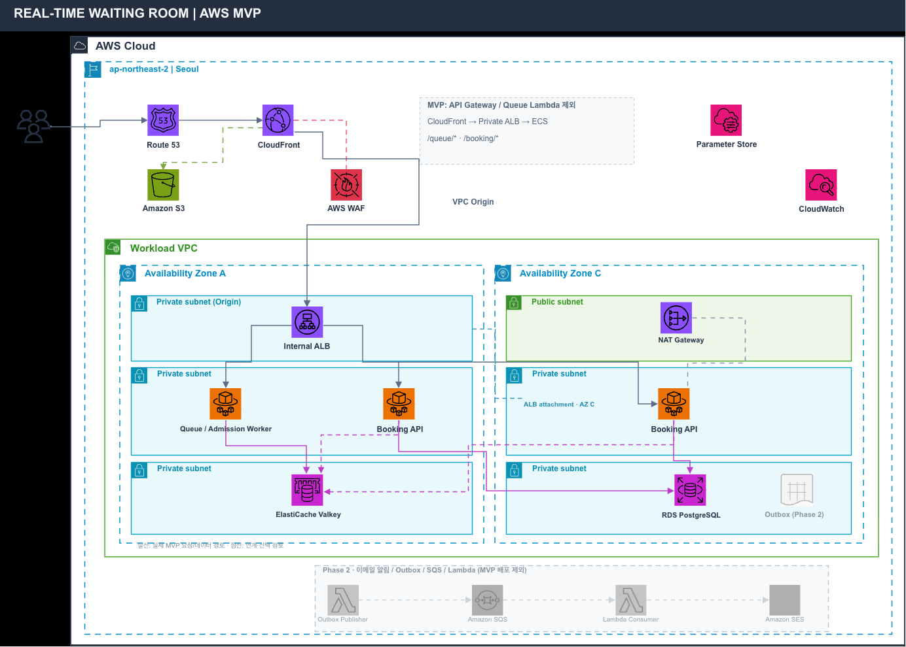

# 실시간 대기열 기반 예약 시스템 (reservation-system-BE)

접속이 한순간에 몰리는 예약 오픈 시점에 사용자를 가상 대기열에 세우고, 백엔드가 감당할 수 있는 속도로만 순서대로 입장시키는 예약 시스템의 백엔드 레포지토리입니다.

> 트래픽 폭주 상황에서도 서버가 죽지 않고, 먼저 온 사람이 먼저 예약하는 공정한 예약 서비스

## 서비스 흐름

이벤트 페이지 진입 → 대기실(내 앞 남은 인원, 전체 대기 인원 표시) → 차례가 되면 입장 → 좌석·시간대 선택(일정 시간 임시 점유) → 예약 확정

차례가 오기 전까지는 대기실에서 현황만 갱신되고, 입장 토큰을 받은 사용자만 좌석·시간대 선택과 예약 확정 단계로 넘어갑니다.

## 주요 기능

- 대기열 등록 및 대기 순서 관리
- 실시간 대기 현황 조회 (내 앞에 남은 인원, 전체 대기 인원)
- 예약 페이지 입장 관리 (입장 토큰)
- 중복 대기 등록, 연속 클릭, 재시도 방지
- 1인 1매 예약 제한

> 기능 범위는 기획 문서의 MoSCoW 기준이며, 개발 진행에 따라 갱신합니다.

## 아키텍처



1. **접속 및 트래픽 방어**: 사용자가 접속하면 Route 53과 CloudFront를 통해 서비스를 제공하고, AWS WAF가 비정상적인 요청을 필터링합니다. CloudFront는 `/queue/*`, `/booking/*` 요청을 VPC Origin을 통해 Private ALB로 전달합니다.
2. **대기열 등록**: ECS에서 동작하는 Queue / Admission Worker가 대기 요청을 접수하고, ElastiCache(Valkey)에 순번과 대기 상태를 저장합니다.
3. **입장 제어**: Queue / Admission Worker가 예약 서버의 처리 용량에 맞춰 대기 순서대로 사용자의 입장을 허용합니다.
4. **예약 처리**: 입장 토큰을 가진 사용자만 Booking API에 접근하며, RDS PostgreSQL 트랜잭션으로 중복 예약을 방지합니다.
5. **모니터링**: CloudWatch에서 대기열 및 예약 처리 상태와 서버 성능을 관찰합니다.
6. **Phase 2 (MVP 제외)**: 예약 정보와 Outbox 이벤트를 함께 저장하고, SQS와 Lambda를 통해 예약 완료 이메일 알림을 별도로 처리합니다.

MVP에서는 API Gateway와 Queue Lambda를 제외하고, CloudFront에서 Private ALB를 거쳐 ECS로 바로 연결합니다. 서울 리전(ap-northeast-2)의 두 가용 영역(A, C)에 서버를 분산 배치합니다.

## 기술 스택

| 구분 | 내용 |
| --- | --- |
| Language | Java 21 |
| Framework | Spring Boot 4.1.3 |
| Build | Gradle (Groovy) |
| Database | PostgreSQL (AWS RDS) |
| ORM | Spring Data JPA (Hibernate) |
| 대기열 저장소 | Valkey (AWS ElastiCache, Redis 호환) - 도입 예정 |
| 기타 | Lombok, Validation, Spring Boot Actuator |
| 테스트 | JUnit, H2 (인메모리 DB, PostgreSQL 모드) |
| 인프라 | AWS (Route 53, CloudFront, WAF, ALB, ECS, CloudWatch, Parameter Store) |

## 시작하기

### 요구 사항

- JDK 21
- PostgreSQL

### 1. 데이터베이스 준비

PostgreSQL에 접속해 데이터베이스를 만듭니다.

```sql
CREATE DATABASE reservation;
```

### 2. 환경변수 설정

DB 접속 정보는 환경변수로 주입하며, 값은 레포지토리에 커밋하지 않습니다. `.env.example`을 참고해 아래 변수를 설정합니다.

| 변수 | 설명 | 예시 |
| --- | --- | --- |
| `DB_URL` | JDBC 접속 주소 | `jdbc:postgresql://localhost:5432/reservation` |
| `DB_USERNAME` | DB 계정 | |
| `DB_PASSWORD` | DB 비밀번호 | |

Spring Boot는 `.env` 파일을 자동으로 읽지 않습니다. 변수가 설정되지 않으면 기본 프로필(`local`)의 애플리케이션 시작이 실패하므로, 실행 전에 아래 방법 중 하나로 환경변수를 적용합니다.

**IntelliJ에서 실행하는 경우**

실행 설정(Run/Debug Configurations)의 Environment variables에 `DB_URL`, `DB_USERNAME`, `DB_PASSWORD`를 입력합니다. 값에 `;`가 들어 있으면 입력칸 오른쪽 아이콘으로 변수별로 나누어 입력합니다.

**터미널에서 실행하는 경우**

`.env`는 `.env.example`을 복사해서 만들며, `DB_URL`처럼 `&` 등이 들어갈 수 있는 값은 따옴표로 감쌉니다. 셸이 `&`를 명령 구분자로 해석하기 때문입니다.

```bash
# macOS / Linux / Git Bash
cp .env.example .env
# .env를 열어 DB_USERNAME과 DB_PASSWORD 값을 입력합니다.
set -a
source .env
set +a
./gradlew bootRun
```

```powershell
# Windows PowerShell (.env는 자동 적용되지 않으므로 직접 설정)
$env:DB_URL = "jdbc:postgresql://localhost:5432/reservation"
$env:DB_USERNAME = "사용자명"
$env:DB_PASSWORD = "비밀번호"
./gradlew bootRun
```

### 3. 실행

기본 프로필은 `local`입니다. 운영 환경에서는 `SPRING_PROFILES_ACTIVE=prod`로 실행합니다.

```bash
./gradlew bootRun
```

### 4. 빌드 및 테스트

테스트는 `test` 프로필(`src/test/resources/application-test.yml`)로 실행되며, 외부 DB 없이 H2 인메모리 DB를 사용합니다. 테스트 클래스에는 `@ActiveProfiles("test")`를 붙입니다.

```bash
./gradlew build
```

## 공통 API 응답과 보안

### 응답과 입력 검증

컨트롤러에서 `BaseResponse.success(data)`로 성공 본문을 만들고, 필요한 경우 `ResponseEntity`로 HTTP 상태를 선택합니다. 성공 코드는 `COMMON_SUCCESS`입니다. HTTP 204는 `ResponseEntity.noContent().build()`로 본문 없이 반환합니다.

```java
return ResponseEntity.status(201).body(BaseResponse.success(data));
```

업무 오류는 해당 `BaseErrorCode`를 선택해 `throw new BusinessException(ErrorCode.CONFLICT)`와 같이 전달합니다. 요청 DTO에는 Bean Validation 제약과 컨트롤러 인자의 `@Valid`를 사용합니다. 검증 오류의 `data.errors`에는 필드명과 사용자용 메시지가 담깁니다.

```json
{
  "success": false,
  "code": "COMMON_400",
  "message": "입력값이 올바르지 않습니다.",
  "data": {"errors": [{"field": "username", "message": "입력값이 올바르지 않습니다."}]}
}
```

### 접근 정책과 CORS

공개 헬스 체크, local·smoke의 Swagger 읽기 경로, 회원가입·로그인·CSRF 토큰 발급 경로 외에는 인증이 필요합니다. Security의 인증 실패와 접근 거부는 각각 `COMMON_401`, `COMMON_403` 응답을 사용합니다. 회원 인증은 Spring Security와 Valkey 기반 Spring Session을 사용하며 비밀번호는 BCrypt로 저장합니다.

브라우저에서 다른 Origin으로 요청할 때는 `CORS_ALLOWED_ORIGINS`에 스킴, 호스트, 필요한 포트를 포함한 Origin을 쉼표로 구분해 설정하고 요청에 credentials를 포함합니다. 허용 목록은 기본적으로 비어 있습니다. `SameSite=Lax` 쿠키를 사용하는 구성에는 같은 사이트의 프론트엔드와 API가 필요합니다.

### Swagger와 헬스 체크

- Swagger UI는 `/swagger-ui/index.html`, OpenAPI JSON은 `/v3/api-docs`입니다.
- DB와 Valkey 없이 확인하려면 `SPRING_PROFILES_ACTIVE=smoke ./gradlew bootRun`을 사용합니다. smoke는 문서와 헬스 체크를 제공하며 회원 API는 local에서 확인합니다.
- `/actuator/health`에서 헬스 상태를 확인할 수 있습니다. 운영 `prod`에서는 Swagger가 비활성화됩니다.

## 회원 인증 로컬 실행 및 검증

기존 PostgreSQL을 준비한 뒤 `docker compose up -d --wait valkey`로 Valkey 8.1.11을 실행합니다. 포트는 `127.0.0.1:6379`이며 필요하면 `VALKEY_PORT`를 지정합니다. `docker compose exec valkey valkey-cli ping`의 `PONG`으로 확인하고, 종료는 `docker compose stop valkey`를 사용합니다.

기존 DB 변수와 필요에 따라 `VALKEY_HOST`, `VALKEY_PORT`, `VALKEY_PASSWORD`, `VALKEY_TLS`를 셸에 내보내거나 IDE 실행 설정에 넣은 뒤 `./gradlew bootRun`을 실행합니다. local 호스트 기본값은 `127.0.0.1`, prod 호스트는 별도 설정이 필요합니다. prod의 TLS 기본값은 `true`입니다. 운영 비밀번호는 실행 환경의 비밀 관리 방식으로 전달합니다. `AUTH_IDLE_TIMEOUT`과 `AUTH_ABSOLUTE_TIMEOUT` 기본값은 각각 `30m`, `12h`입니다.

| 메서드·경로 | 세션 | 요청 | 성공 |
| --- | --- | --- | --- |
| GET `/api/auth/csrf` | 익명 또는 인증 | 본문 없음 | 200, `data.headerName` 및 `data.token` |
| POST `/api/members` | 익명 허용 | `{"username":"testuser","password":"test1234!"}` | 201, `data.memberId` 및 `data.username` |
| POST `/api/auth/login` | 익명 허용 | 회원가입과 동일 | 200, 동일한 회원 정보 및 `ASBG_SESSION` 쿠키 |
| POST `/api/auth/logout` | 인증 필요 | 본문 없음 | 204, 빈 본문 및 쿠키 만료 |
| DELETE `/api/members/me` | 인증 필요 | `{"password":"test1234!"}` | 204, 빈 본문 및 쿠키 만료 |

로그인과 가입의 응답 예시입니다. 가입 성공 후 로그인이 필요합니다.

```json
{"success":true,"code":"COMMON_SUCCESS","message":"요청에 성공했습니다.","data":{"memberId":1,"username":"testuser"}}
```

Swagger에서는 같은 브라우저에서 CSRF 경로를 호출하고, 변경 요청의 `X-CSRF-TOKEN` 파라미터에 응답의 `data.token`을 입력합니다. 브라우저가 `ASBG_SESSION`을 전송합니다. 로그인으로 인증 상태가 바뀌면 CSRF 토큰을 다시 받습니다. 로그아웃이나 탈퇴 후 다음 변경 요청 전에도 다시 받습니다. 반복 로그아웃은 유효한 세션과 토큰을 사용할 수 없으면 401 또는 403입니다.

| 상태 | 코드 | 조건 |
| --- | --- | --- |
| 400 | `COMMON_400`, `COMMON_400_BODY` | 입력 제약 위반 또는 잘못된 JSON |
| 401 | `COMMON_401`, `MEMBER_401_1`, `MEMBER_401_2` | 인증 필요, 로그인 입력 불일치, 탈퇴 비밀번호 불일치 |
| 403 | `COMMON_403` | CSRF 등 Security 접근 거부 |
| 409 | `MEMBER_409_1`, `MEMBER_409_2`, `MEMBER_409_3` | 중복 아이디, 활성 세션 충돌, FK로 인한 탈퇴 제한 |
| 503 | `COMMON_503` | 인증 저장소를 사용할 수 없고 오류 응답을 쓸 수 있는 상태 |

`RUN_VALKEY_TESTS=true ./gradlew test build`로 실제 Valkey와 H2를 쓰는 인증 테스트 및 기존 회귀 테스트를 실행합니다. 선택적으로 **전용 임시 PostgreSQL DB**의 `AUTH_TEST_DB_URL`, `AUTH_TEST_DB_USERNAME`, `AUTH_TEST_DB_PASSWORD`를 지정하고 `--rerun-tasks`를 붙일 수 있습니다. 테스트는 스키마를 생성·삭제하므로 운영 또는 기존 개발 DB를 지정하지 않습니다.

### 운영 PostgreSQL 적용

운영 설정의 `ddl-auto: none`을 유지합니다. 새 운영 스키마에 회원 테이블이 없다면 배포 전 DBA 검토 및 기존 DDL 적용 절차에 따라 적용합니다. 이미 테이블이 있다면 기존 제약과 정규화 데이터를 먼저 확인합니다.

```sql
CREATE TABLE member (
    member_id BIGINT GENERATED BY DEFAULT AS IDENTITY PRIMARY KEY,
    username VARCHAR(50) NOT NULL,
    password VARCHAR(255) NOT NULL,
    created_at TIMESTAMP NOT NULL DEFAULT CURRENT_TIMESTAMP,
    CONSTRAINT uk_member_username UNIQUE (username)
);
```

### 기존 로컬 PostgreSQL의 회원 테이블 이름 변경

API를 중지한 뒤, 기존 로컬 DB에서 아래 조회를 먼저 실행합니다. 예시는 `public` 스키마 기준입니다. 다른 스키마를 쓴다면 조회와 변경 SQL에 같은 스키마를 지정합니다.

```sql
SELECT to_regclass('public.members') AS old_table,
       to_regclass('public.member') AS new_table;

SELECT conname, pg_get_constraintdef(oid) AS definition
FROM pg_constraint
WHERE conrelid = to_regclass('public.members')
  AND conname = 'uk_members_username';
```

`old_table`이 존재하고 `new_table`이 `NULL`이며 조회된 제약조건이 `UNIQUE (username)`일 때만 아래 변경을 한 트랜잭션으로 실행합니다. 두 테이블이 모두 있거나 기존 제약조건이 없으면 먼저 현재 스키마를 확인합니다. 변경 후에는 API를 다시 시작합니다.

```sql
BEGIN;

ALTER TABLE public.members RENAME TO member;

ALTER TABLE public.member
RENAME CONSTRAINT uk_members_username TO uk_member_username;

COMMIT;
```

### 세션 저장 및 향후 Queue Lambda 연동

`ASBG_SESSION`은 Spring Session 기본 Base64 인코딩을 사용하는 HttpOnly 쿠키입니다. Path는 `/`, SameSite는 `Lax`, Secure는 prod에서 활성화됩니다. Spring Session 4.1.2의 Redis 세션 키는 `asbg:auth:session:sessions:<sessionId>`이며, `sessionAttr:SPRING_SECURITY_CONTEXT`에 Spring Security 인증이 JDK 직렬화로 저장됩니다. 인증 주체는 `MemberPrincipal(memberId, username)`이며 인증 자격 증명은 세션에 저장하지 않습니다. 이 저장 형식은 외부 공개 계약이 아니므로 Java 타입과 직렬화 호환성을 함께 검증해야 합니다.

`asbg:auth:active:<memberId>`의 값은 활성 세션의 ID입니다. 보호 요청은 세션이 유효하며 키 소유자가 일치할 때 허용됩니다. Valkey의 원자적 획득과 소유자 일치 삭제, PostgreSQL 회원 행 잠금으로 로그인·탈퇴 경쟁을 조정합니다. 유휴 만료는 Spring Session에서 갱신되며 활성 키 TTL로 최초 로그인 기준 절대 만료를 제한합니다. 동일 세션 재로그인은 절대 만료 시간을 연장하지 않습니다.

로그아웃은 활성 키를 폐기하고 세션을 삭제합니다. 탈퇴는 비밀번호 확인 후 같은 방식으로 인증을 먼저 폐기하고 회원을 삭제합니다. 삭제가 FK 등으로 실패하면 회원은 남고 다시 로그인할 수 있습니다. Valkey 접근이 실패하면 인증·상태 변경을 허용하지 않습니다. 이 순서는 DB와 Valkey 사이의 단일 트랜잭션을 전제하지 않습니다.

Queue Lambda는 Spring MVC의 세션 필터가 자동 적용되는 환경이 아니므로 세션과 활성 키, 쿠키 파싱, 유휴 갱신 및 절대 만료를 일관되게 검증해야 합니다. CloudFront에서 인증 쿠키가 해당 Origin으로 전달되도록 구성하고 사용자별 응답과 대기 현황의 공유 캐싱을 방지해야 합니다. Lambda의 쿠키 기반 상태 변경에도 CSRF 보호가 필요합니다. 실제 연동은 후속 단계에서 검증합니다.

## 프로젝트 구조

기능별 패키지(`domain`)와 공통 코드(`global`)로 구성합니다.

```
src/
  main/
    java/com/asbg/backend/
      domain/
        <기능>/
          controller/   # HTTP 요청과 응답
          service/      # 유스케이스와 트랜잭션
          domain/       # 엔티티와 도메인 규칙
          repository/   # 데이터 접근
          dto/          # request, response
      global/
        config/         # 공통 설정
        exception/      # 공통 예외 처리
    resources/
      application.yml
      application-local.yml
      application-prod.yml
  test/
    java/com/asbg/backend/
    resources/
      application-test.yml
```

## 협업 규칙

### 요청 DTO 검증

공통 검증 오류는 필드 단위로 반환합니다. 요청 DTO의 Bean Validation 제약은 필드나 record 컴포넌트에 선언합니다. 여러 필드 간 관계를 검증해야 하는 경우에는 먼저 클래스 수준 오류의 공통 응답 형식을 정합니다.

### 브랜치 전략

| 브랜치 | 설명 |
| --- | --- |
| `main` | 운영 배포용 브랜치 |
| `develop` | 개발 통합 브랜치 (기본 브랜치) |
| `{타입}/{작업-관련-브랜치명}` | 작업별 개발 브랜치. 예: `feat/user-register` |

작업 브랜치에서 개발하고 push한 뒤, PR을 통해 `develop`으로 병합하고 브랜치를 삭제합니다.
브랜치 타입: `feat`, `fix`, `chore`, `refactor`, `build`, `deploy`, `test`

### 커밋 컨벤션

```
{타입}: {커밋 메시지}
```

예시: `feat: 회원가입 및 로그인 구현`
커밋 타입: `feat`, `fix`, `chore`, `refactor`, `merge`, `build`, `deploy`, `test`, `docs`, `hotfix`

### 이슈와 Pull Request

- 이슈 제목은 `[타입] 작업 내용` 형식으로 작성합니다. 예: `[chore] 스프링부트 프로젝트 초기 설정`
- PR 제목은 커밋 컨벤션과 같은 `타입: 작업 내용` 형식으로 작성합니다. 예: `chore: 스프링부트 프로젝트 초기 설정`
- PR 본문에 `Closes #이슈번호`를 적어 이슈와 연결합니다.
- PR은 승인(approve) 1명 이상이 있어야 병합할 수 있습니다.
- 병합 커밋 메시지는 PR 제목이 기본값으로 들어가므로 별도로 고치지 않아도 됩니다.
- PR을 올리면 CodeRabbit이 자동으로 리뷰합니다.

## 팀원

| 이름 | GitHub |
| --- | --- |
| 김서윤 | [SY0518](https://github.com/SY0518) |
| 김민주 | [mminjukim](https://github.com/mminjukim) |
| 이서현 | [seoL-ee](https://github.com/seoL-ee) |
| 이주연 | [leejuyeon7852](https://github.com/leejuyeon7852) |
| 임가영 | [lojhbm](https://github.com/lojhbm) |
| 정승민 | [snmng06](https://github.com/snmng06) |